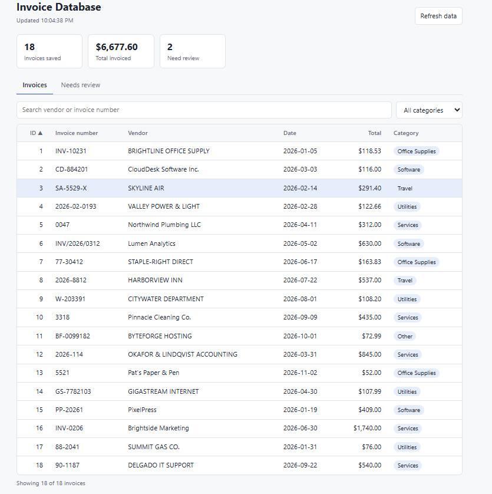

# AI-Enabled Document Intake Workflow

An intelligent document processing pipeline that turns invoice text files into structured, validated data. An n8n workflow reads each invoice, a local LLM extracts the key fields as JSON, validation rules check the output, valid records are saved to PostgreSQL, and anything questionable goes to a human review queue. A small C# API and web page let you browse the results.

All sample invoices are synthetic. Everything runs locally, with no API keys and no data leaving your machine.



## How it works

```
Invoice files (.txt)
        |
   n8n workflow
        |
  Read files -> Extract text -> Local LLM (Ollama) -> Validate (Code node) -> IF
                                                                              |
                                              valid   -> PostgreSQL: invoices
                                              invalid -> PostgreSQL: review_queue
                                                                              |
                                                  C# API + web page (read the database)
```

1. **Read:** n8n reads every `.txt` file in the `invoices/` folder.
2. **Extract:** a local LLM (Hermes 3 8B, run through Ollama) reads each invoice and returns `invoice_number`, `vendor`, `invoice_date`, `total`, and `category` as JSON. The prompt asks for JSON only and for `null` when a field is missing.
3. **Validate:** a JavaScript Code node parses the reply and checks it. LLM output is never saved without passing these checks.
4. **Route:** an IF node sends valid records to the `invoices` table and invalid ones to `review_queue`, along with the reason and the raw model output.
5. **View:** an ASP.NET Core app reads both tables and exposes them as JSON and as a simple web page.

### Validation rules
A record is valid only if:
- `invoice_number` and `vendor` are present
- `invoice_date` is a real date in `YYYY-MM-DD` format
- `total` is a number greater than zero
- `category` is one of: Office Supplies, Software, Travel, Utilities, Services, Other

Saving uses `ON CONFLICT (invoice_number) DO NOTHING`, so rerunning the workflow does not create duplicate invoices.

## Tech stack
- **n8n** for workflow orchestration
- **Ollama** running `hermes3:8b` as the local LLM
- **PostgreSQL 16** for storage
- **C# / ASP.NET Core** (minimal API with Npgsql) and a plain HTML/JavaScript page
- **Docker Compose** to run n8n and PostgreSQL

## Testing

The pipeline was tested on 20 synthetic invoices in varied layouts, including a few with missing fields. Records with missing or invalid fields are caught by the validation step and appear in the review queue instead of the invoices table, and the review queue shows the reason for each one.

`expected.csv` is a hand-checked answer key. To check the pipeline yourself, run the workflow, then compare the saved records to the key:

```
docker compose exec postgres psql -U intake -d intake -c "SELECT invoice_number, vendor, invoice_date, total, category FROM invoices ORDER BY invoice_number;"
```

Small local models make mistakes, especially on judgment calls like category. That is the reason for the validation step and the review queue.

## Repository contents

```
docker-compose.yml   n8n and PostgreSQL
init.sql             creates the invoices and review_queue tables
workflow.json        exported n8n workflow
invoices/            20 synthetic sample invoices
expected.csv         hand-checked answer key
InvoiceApi/          C# API and web page
image.png            screenshot of the web page
```

## Run it yourself

**Prerequisites:** Docker Desktop, [Ollama](https://ollama.com), and the .NET 8 SDK (or newer).

1. **Download the model**
   ```
   ollama pull hermes3:8b
   ```
   An 8B model needs roughly 8 GB of free RAM. On a smaller machine, use `llama3.2:3b` instead and select it in the n8n model node.
2. **Start n8n and PostgreSQL**
   ```
   docker compose up -d
   ```
   n8n is at http://localhost:5678. Create a local account on first visit.
3. **Check that the tables exist** (they are created from `init.sql` on first start)
   ```
   docker compose exec postgres psql -U intake -d intake -c "\dt"
   ```
   You should see `invoices` and `review_queue`. If not, run `init.sql` manually:
   ```
   Get-Content init.sql | docker compose exec -T postgres psql -U intake -d intake
   ```
4. **Import the workflow:** in n8n, create a workflow, open the menu, choose Import, and select `workflow.json`.
5. **Add credentials in n8n**
   - Postgres: host `postgres`, database `intake`, user `intake`, password `intake`, port `5432`, SSL off
   - Ollama: base URL `http://host.docker.internal:11434`
6. **Run the workflow** with Execute workflow. A local model takes a few seconds to a minute per invoice.
7. **Start the web app and API**
   ```
   cd InvoiceApi
   dotnet run
   ```
   Open the address it prints (for example http://localhost:5189).

| Path | Description |
| --- | --- |
| `/` | Web page: browse, search, sort, and filter the database |
| `/api/invoices` | Saved invoices as JSON |
| `/api/review-queue` | Flagged items as JSON |

## Notes and limitations
- The `review_queue` table is not cleared between runs, so rerunning adds the flagged items again. Clear it with `TRUNCATE review_queue RESTART IDENTITY;` before a fresh run.
- n8n can only read files in the mounted `/files` folder, which is allowed through `N8N_RESTRICT_FILE_ACCESS_TO` in `docker-compose.yml`.
- The database credentials in this repo are for local demo use only.

## Next steps
- Support PDF invoices, and OCR for scanned documents
- Add a review screen where a person can correct and approve flagged records
- Store the source file name with each record and prevent duplicate review entries
- Add authentication to the API
- Add Ollama to Docker Compose so one command starts everything
